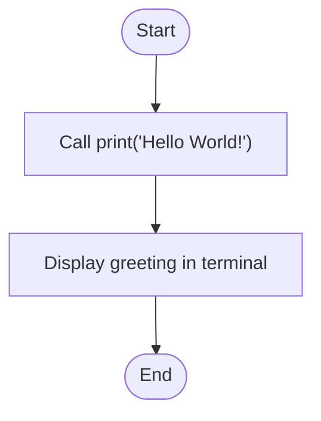

# Hello World

Print a greeting in the terminal using Python's built-in `print()` function.

## Problem Summary
Display the message `Hello World!`.

## Logic & Approach
The program passes a string to `print()`. Python writes the string to the
terminal and ends the line.

## Time & Space Complexity
| Measure | Complexity |
|---|---:|
| Time | O(1) |
| Space | O(1) |

## Example Input & Output
```text
Input: None

Hello World!
```

## Program Flow


## Run
Run with Python 3:
```bash
python hello_world.py
```
