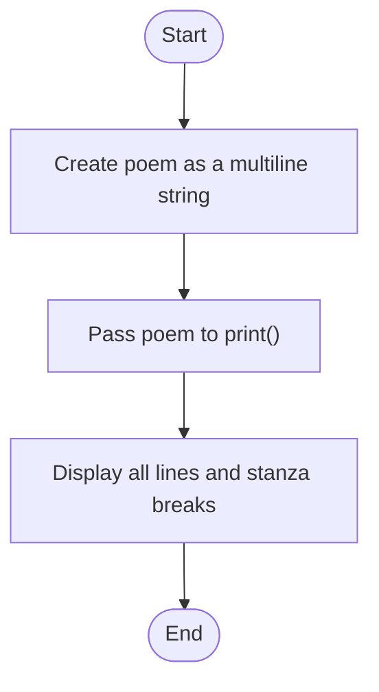

# Twinkle Twinkle Poem

Print the complete "Twinkle, Twinkle, Little Star" poem while preserving its
lines and stanza breaks.

## Problem Summary
Display a multiline poem in the terminal.

## Logic & Approach
The poem is stored in a triple-quoted string. Python keeps the line breaks
inside that string, and `print()` writes the text to standard output.

## Time & Space Complexity
For a poem containing *n* characters:

| Measure | Complexity |
|---|---:|
| Time | O(n) |
| Space | O(n) |

## Example Input & Output
```text
Input: None

Twinkle, twinkle, little star,
How I wonder what you are!
Up above the world so high,
Like a diamond in the sky.

... the remaining poem is printed in full ...
```

## Program Flow


## Run
Run with Python 3:
```bash
python twinkle_poem.py
```
