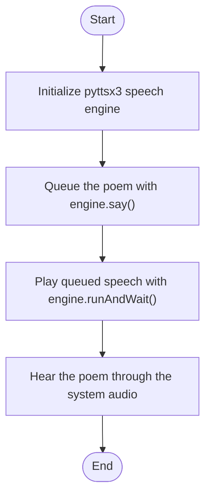

# Text-to-Speech: Twinkle Twinkle

Speak the "Twinkle, Twinkle, Little Star" poem using a local text-to-speech
engine.

## Problem Summary
Convert the poem text into spoken audio with the `pyttsx3` package.

## Logic & Approach
The program initializes the default `pyttsx3` speech engine, queues the poem
with `engine.say(...)`, then calls `engine.runAndWait()` to play the queued
speech and wait for playback to finish.

## Requirements
- Python 3
- The `pyttsx3` package
- A supported speech engine and voice installed on the operating system

Install the package with:
```bash
python -m pip install pyttsx3
```

## Example Input & Output
```text
Input: None

Output: The speech engine reads the poem aloud.
```

## Program Flow


## Run
Run with Python 3:
```bash
python text_to_speech.py
```

## Notes
- On Windows, `pyttsx3` normally uses SAPI5 voices. Other operating systems
  use their supported speech engines.
- If Python reports `No module named 'pyttsx3'`, install the package using the
  command above with the same Python interpreter used to run the program.
- If playback fails, check that a supported speech engine and at least one
  usable voice are installed.
