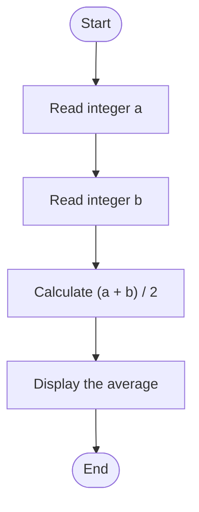

# Average of Two Numbers

Read two integers and calculate their arithmetic average.

## Problem Summary
Display the average of two numbers entered by the user.

## Logic & Approach
The program reads two integers, adds them, and divides their sum by `2`. In
Python, `/` returns a floating-point result, so averages with a fractional part
are preserved.

## Time & Space Complexity
| Measure | Complexity |
|---|---:|
| Time | O(1) |
| Space | O(1) |

## Example Input & Output
```text
Enter a Number a : 4
Enter a number b : 7
The average of two numbers is  5.5
```

## Program Flow


## Run
Run with Python 3:
```bash
python average.py
```
