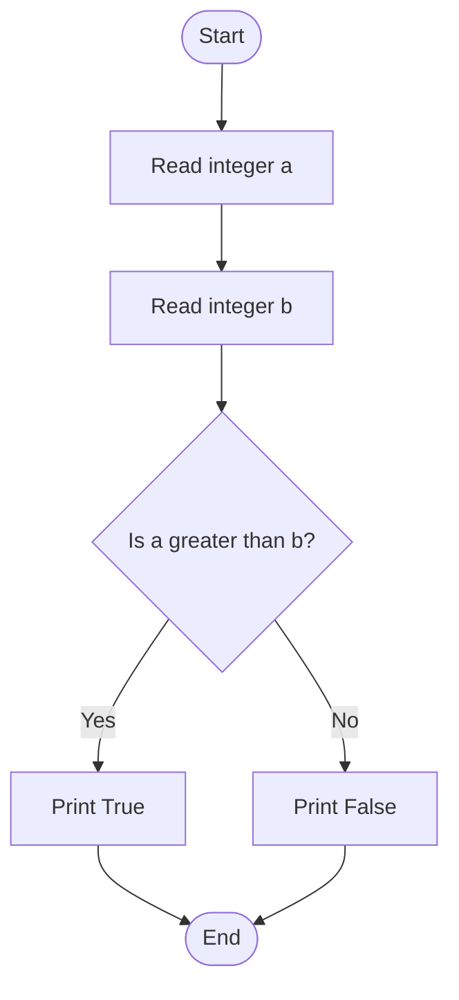

# Compare Two Numbers

Read two integers and check whether the first is greater than the second.

## Problem Summary
Display the result of comparing two user-entered numbers with `>`.

## Logic & Approach
The program reads two integers, evaluates `a > b`, and prints the resulting
Boolean value: `True` when the first number is greater and `False` otherwise.

## Time & Space Complexity
| Measure | Complexity |
|---|---:|
| Time | O(1) |
| Space | O(1) |

## Example Input & Output
```text
Enter a Number a : 9
Enter a number b : 4
True
```

## Program Flow


## Run
Run with Python 3:
```bash
python greater_num.py
```
