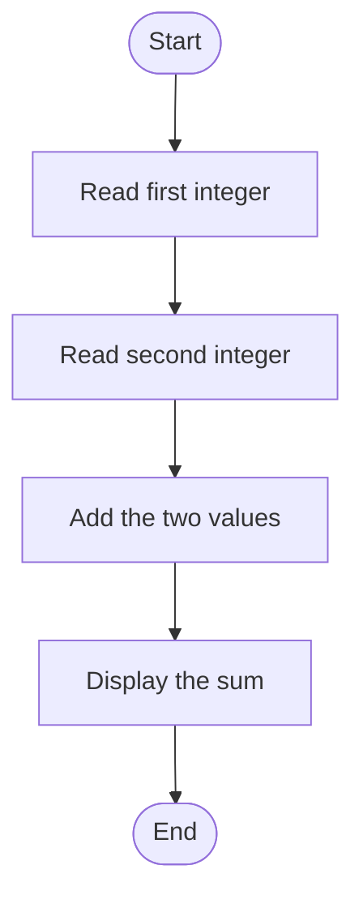

# Add Two Input Numbers

Read two integers from the user and print their sum.

## Problem Summary
Calculate and display the total of two user-entered numbers.

## Logic & Approach
The program converts each input to an integer, adds the values, and prints the
result with a short message.

## Time & Space Complexity
| Measure | Complexity |
|---|---:|
| Time | O(1) |
| Space | O(1) |

## Example Input & Output
```text
Enter a number: 8
Enter another number: 2
The sum of 2 numbers is  10
```

## Program Flow


## Run
Run with Python 3:
```bash
python input_sum.py
```
