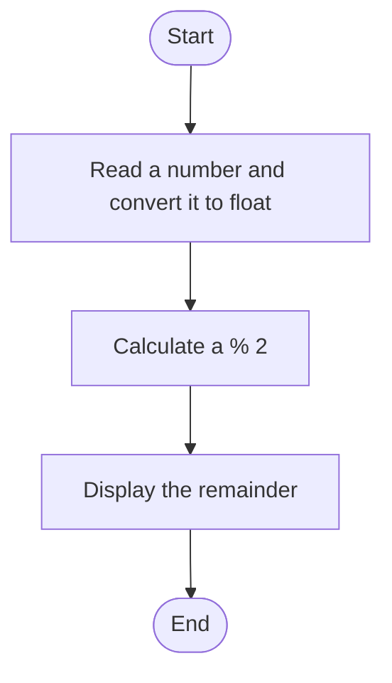

# Remainder After Division by Two

Read a number and display its remainder when divided by `2`.

## Problem Summary
Demonstrate the modulo operator with a user-entered floating-point number.

## Logic & Approach
The program converts the input to a `float`, applies the modulo operator
(`%`) with `2`, and prints the remainder. For whole-number input, this can be
used to distinguish even and odd values.

## Time & Space Complexity
| Measure | Complexity |
|---|---:|
| Time | O(1) |
| Space | O(1) |

## Example Input & Output
```text
Enter a number : 7
The reminder when the number is divided by 2 is :  1.0
```

## Program Flow


## Run
Run with Python 3:
```bash
python reminder.py
```
