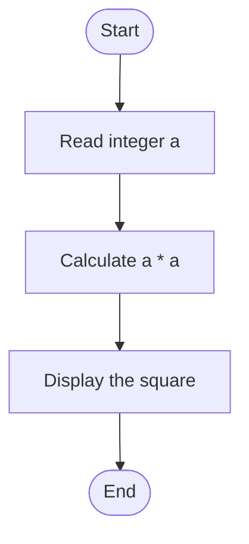

# Square a Number

Read an integer and calculate its square.

## Problem Summary
Multiply a user-entered number by itself and display the result.

## Logic & Approach
The program converts the input to an integer, multiplies `a` by `a`, and
prints the square.

## Time & Space Complexity
| Measure | Complexity |
|---|---:|
| Time | O(1) |
| Space | O(1) |

## Example Input & Output
```text
Enter a Number a : 5
The Square of the numbers is  25
```

## Program Flow


## Run
Run with Python 3:
```bash
python square.py
```
