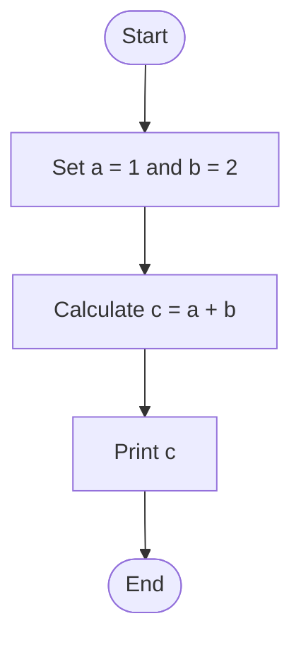

# Add Two Fixed Numbers

Add two values assigned directly in the Python program.

## Problem Summary
Display the sum of the fixed values `1` and `2`.

## Logic & Approach
The program assigns `1` to `a` and `2` to `b`, calculates `a + b`, stores the
result in `c`, and prints it. No user input is required.

## Time & Space Complexity
| Measure | Complexity |
|---|---:|
| Time | O(1) |
| Space | O(1) |

## Example Input & Output
```text
Input: None

3
```

## Program Flow


## Run
Run with Python 3:
```bash
python sum.py
```
