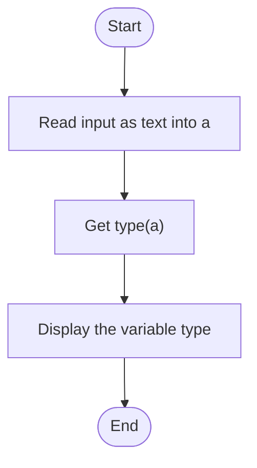

# Check a Variable's Type

Read a value and display the type of the resulting variable.

## Problem Summary
Demonstrate Python's `input()` function and built-in `type()` function.

## Logic & Approach
The program reads text with `input()` and stores it in `a`. Since `input()`
returns a string, `type(a)` reports `<class 'str'>`, regardless of what the
user types.

## Time & Space Complexity
For an input containing *n* characters:

| Measure | Complexity |
|---|---:|
| Time | O(1) |
| Space | O(n) |

## Example Input & Output
```text
Enter anything to check the type: 42
The type of the variable is: <class 'str'>
```

## Program Flow


## Run
Run with Python 3:
```bash
python type_of_variable.py
```
