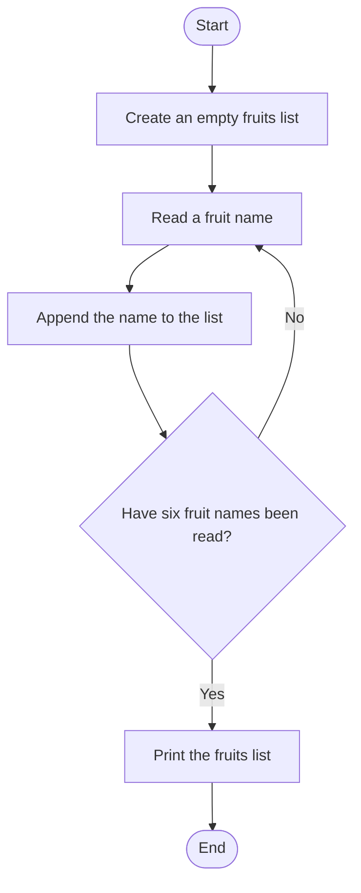

# Fruit List

Read six fruit names and display them together as a Python list.

## Problem Summary
Collect six text values using `input()` and store them in a list.

## Logic & Approach
The program creates an empty `fruits` list, reads six fruit names, appends each
name to the list, and prints the completed list.

## Time & Space Complexity
For *n* fruit names:

| Measure | Complexity |
|---|---:|
| Time | O(n) |
| Space | O(n) |

## Example Input & Output
```text
Enter fruits : Apple
Enter fruits : Banana
Enter fruits : Mango
Enter fruits : Orange
Enter fruits : Grapes
Enter fruits : Peach
['Apple', 'Banana', 'Mango', 'Orange', 'Grapes', 'Peach']
```

## Program Flow


## Run
Run with Python 3:
```bash
python fruits.py
```
