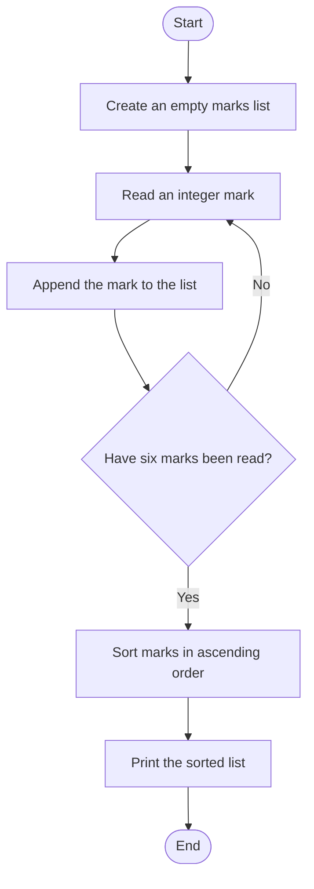

# Sort Six Marks

Read six integer marks and print them in ascending order.

## Problem Summary
Collect six marks, sort them from lowest to highest, and display the sorted
list.

## Logic & Approach
The program reads six integers and appends them to `marks`. It then calls
`marks.sort()`, which sorts the list in place, before printing the list.

## Time & Space Complexity
For *n* marks:

| Measure | Complexity |
|---|---:|
| Time | O(n log n) |
| Space | O(n) |

## Example Input & Output
```text
Enter marks here : 72
Enter marks here : 85
Enter marks here : 64
Enter marks here : 91
Enter marks here : 78
Enter marks here : 69
[64, 69, 72, 78, 85, 91]
```

## Program Flow


## Run
Run with Python 3:
```bash
python marks.py
```
