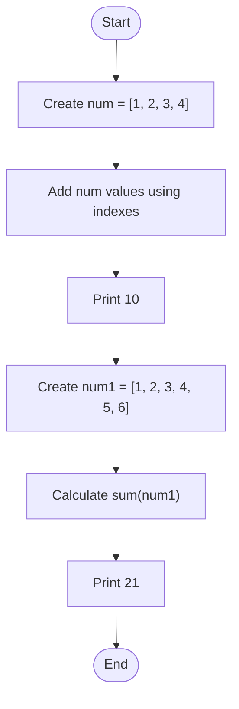

# Sum of List Values

Demonstrate two ways to add all values in a list.

## Problem Summary
Print the sum of one list using explicit indexing and the sum of another list
using Python's built-in `sum()` function.

## Logic & Approach
The first method adds the four elements of `num` by their indexes and prints
`10`. The second method passes `num1` to `sum()` and prints `21`.

## Time & Space Complexity
For a list containing *n* values, Python's built-in `sum()` takes O(n) time.
The lists in this example have fixed lengths.

| Measure | Complexity |
|---|---:|
| Time | O(n) |
| Extra space | O(1) |

## Example Input & Output
```text
Input: None

10
21
```

## Program Flow


## Run
Run with Python 3:
```bash
python sum_of_list.py
```
