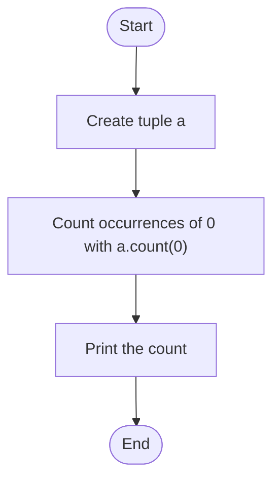

# Count Zeros in a Tuple

Count and display how many zero values appear in a tuple.

## Problem Summary
Use the tuple `count()` method to find the number of zeros in a tuple.

## Logic & Approach
The program stores seven integers in `a`, calls `a.count(0)`, and prints the
result. The tuple contains three zeros, so the output is `3`.

## Time & Space Complexity
For a tuple containing *n* values:

| Measure | Complexity |
|---|---:|
| Time | O(n) |
| Extra space | O(1) |

## Example Input & Output
```text
Input: None

3
```

## Program Flow


## Run
Run with Python 3:
```bash
python zeroCount.py
```
