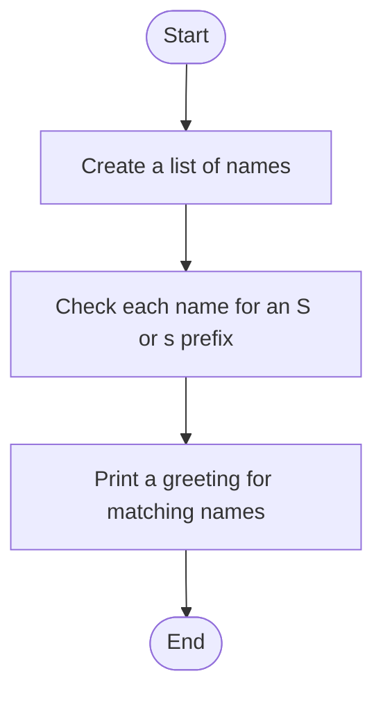

# Greet Names Starting with S

Print a greeting for each name in a fixed list that starts with `S` or `s`.

## Problem Summary
Filter a list of names by their first letter and greet the matching names.

## Logic & Approach
The program loops through the list and checks whether each name starts with
`S` or `s`. It prints a greeting for each match.

## Time & Space Complexity
For *n* names:

| Measure | Complexity |
|---|---:|
| Time | O(n) |
| Space | O(1) |

## Example Input & Output
```text
Input: None

Hello Sobham, How are you!
Hello Subhan, How are you!
Hello sonia, How are you!
```

## Program Flow


## Run
Run with Python 3:
```bash
python Greetings-NamewithS.py
```
