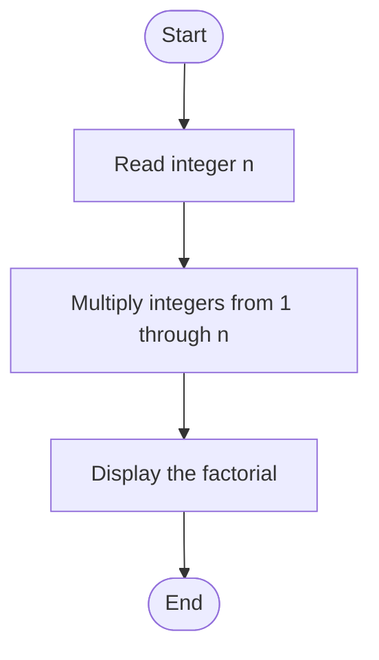

# Factorial

Read an integer and calculate its factorial with a loop.

## Problem Summary
Display the factorial of a non-negative integer entered by the user.

## Logic & Approach
The program starts with a product of `1` and multiplies it by each integer
from `1` through the input value.

## Time & Space Complexity
For input *n*:

| Measure | Complexity |
|---|---:|
| Time | O(n) |
| Space | O(1) |

## Example Input & Output
```text
Enter a number to find factorial : 5
Factori of 5 is 120
```

## Program Flow


## Run
Run with Python 3:
```bash
python factorial.py
```
