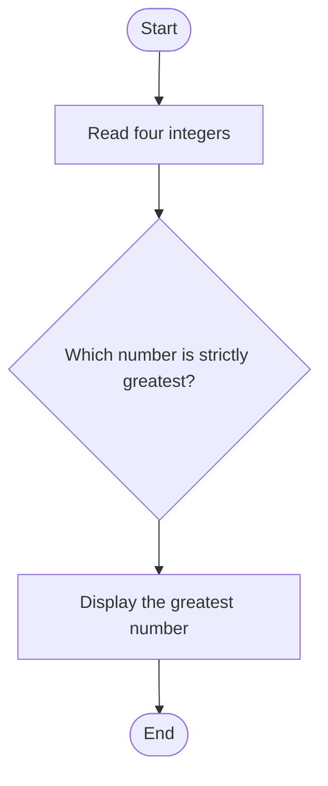

# Greatest of Four Numbers

Read four integers and display the greatest one.

## Problem Summary
Compare four user-entered numbers and print the greatest number.

## Logic & Approach
The program compares each number with the other three. If the first three
checks do not find a strictly greatest value, it prints the fourth number.

## Time & Space Complexity
| Measure | Complexity |
|---|---:|
| Time | O(1) |
| Space | O(1) |

## Example Input & Output
```text
Enter 1st number : 3
Enter 2nd number : 8
Enter 3rd number : 2
Enter 4th number : 5
Greatest number is 8
```

## Program Flow


## Run
Run with Python 3:
```bash
python greatest_num.py
```
