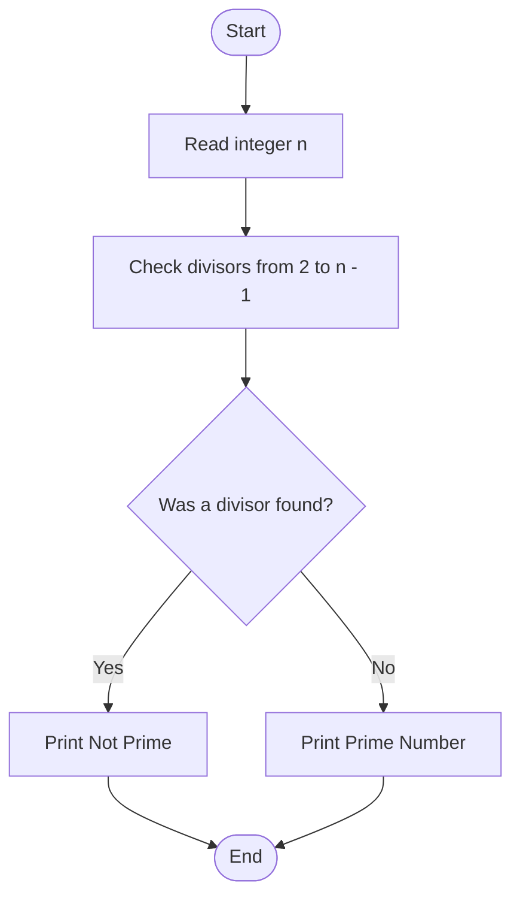

# Check Prime Number

Read an integer and test whether it has a divisor between `2` and one less
than the number.

## Problem Summary
Print a prime or non-prime message based on the divisibility test.

## Logic & Approach
The program checks each integer in `range(2, n)`. If any divides `n`, it
prints `Not Prime`; otherwise, the loop's `else` clause prints `Prime Number`.

## Time & Space Complexity
For input *n*:

| Measure | Complexity |
|---|---:|
| Time | O(n) |
| Space | O(1) |

## Example Input & Output
```text
Enter a number : 7
Prime Number
```

## Program Flow


## Run
Run with Python 3:
```bash
python prime-number.py
```
