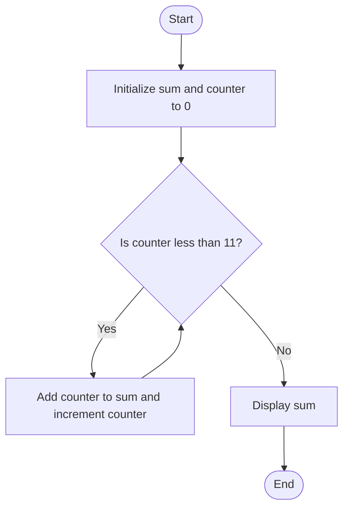

# Sum of the First Ten Natural Numbers

Add the integers from `0` through `10` using a `while` loop.

## Problem Summary
Calculate and display the sum of the first ten positive natural numbers.

## Logic & Approach
The program initializes the sum and counter to `0`, then adds each counter
value while the counter is less than `11`.

## Time & Space Complexity
| Measure | Complexity |
|---|---:|
| Time | O(1) |
| Space | O(1) |

## Example Input & Output
```text
Input: None

sum first 10 natural numbers is  55
```

## Program Flow


## Run
Run with Python 3:
```bash
python sum-of-10naturalnumbers.py
```
