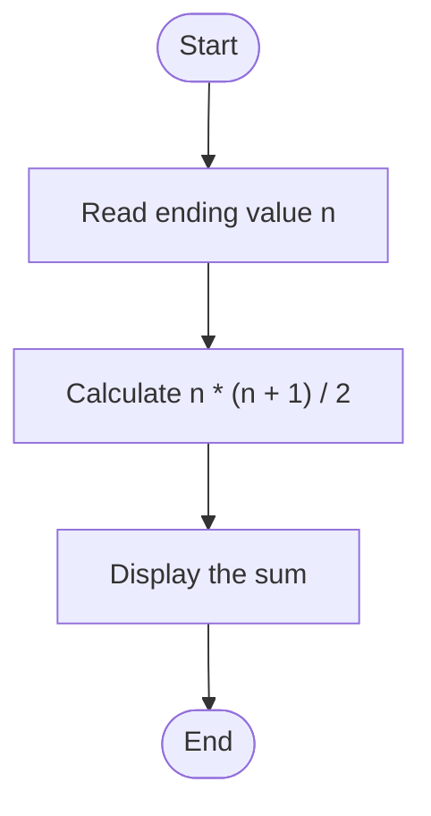

# Sum of Natural Numbers

Read an ending value and calculate the sum from zero through that value.

## Problem Summary
Use the arithmetic-series formula to sum the integers up to the input value.

## Logic & Approach
The program reads `n` and evaluates `n * (n + 1) / 2`, then displays the
result.

## Time & Space Complexity
| Measure | Complexity |
|---|---:|
| Time | O(1) |
| Space | O(1) |

## Example Input & Output
```text
Enter Ending range of natural number to sum : 5
sum of all natural numbers from 5 to 0 is 15.0
```

## Program Flow


## Run
Run with Python 3:
```bash
python sum-of-naturalnumber.py
```
