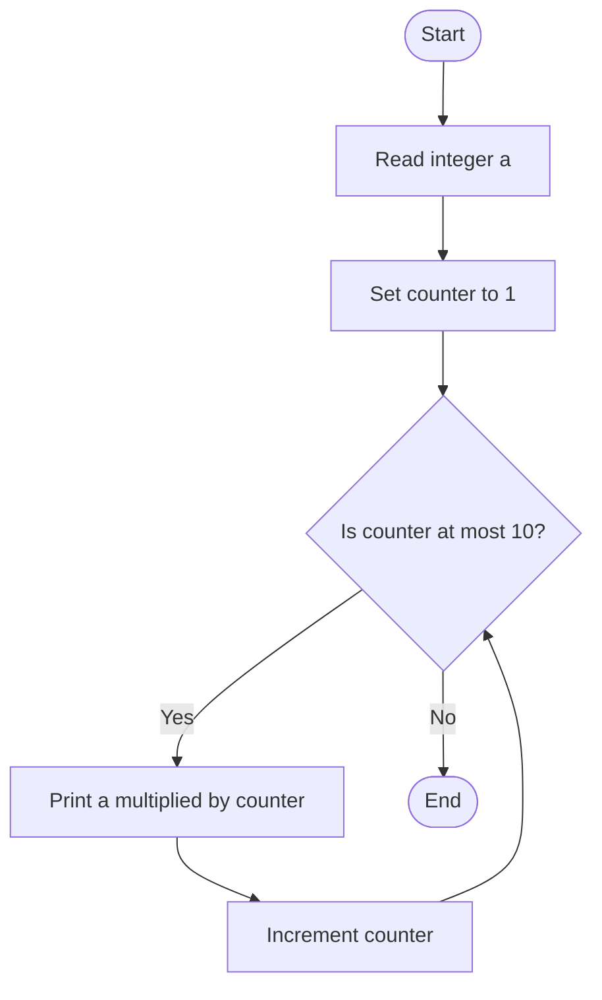

# Multiplication Table with a While Loop

Read an integer and print its multiplication table from 1 through 10.

## Problem Summary
Display the first ten multiples of a user-entered number.

## Logic & Approach
The program starts a counter at `1` and uses a `while` loop to print each
multiple until the counter reaches `10`.

## Time & Space Complexity
| Measure | Complexity |
|---|---:|
| Time | O(1) |
| Space | O(1) |

## Example Input & Output
```text
Enter the Number of Which you Want to find table : 3
3 x 1 = 3
3 x 2 = 6
...
3 x 10 = 30
```

## Program Flow


## Run
Run with Python 3:
```bash
python table-while.py
```
