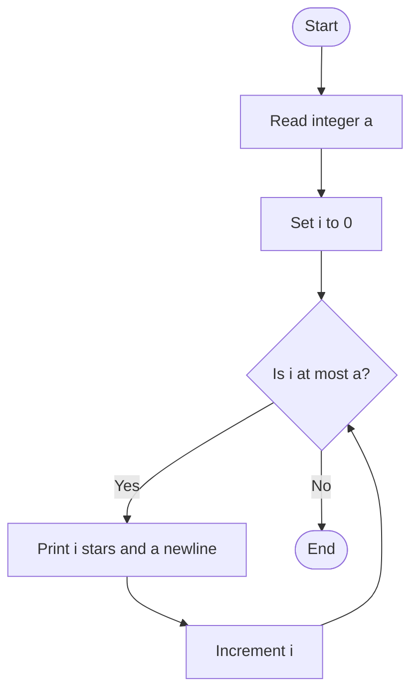

# Star Pattern

Read an integer and print a growing triangle of stars, preceded by a blank line.

## Problem Summary
Display an empty line, then one star, two stars, and continue until the input
number is reached.

## Logic & Approach
The program iterates from `0` through the input number and prints a string
containing that many stars on each line. The first iteration prints an empty
line.

## Time & Space Complexity
| Measure | Complexity |
|---|---:|
| Time | O(n^2) |
| Space | O(n) |

## Example Input & Output
```text
Enter a Number : 4

*
**
***
****
```

## Program Flow


## Run
Run with Python 3:
```bash
python stars.py
```
