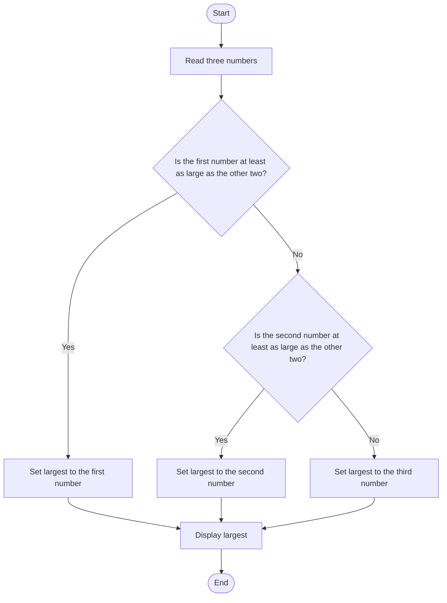

# Largest of Three Numbers

Read three numbers and display the largest one.

## Problem Summary
Compare three user-entered numbers and print the largest value.

## Logic & Approach
The program checks whether the first number is at least as large as both
others, then does the same for the second number. If neither condition holds,
the third number is the largest. Using `>=` also handles equal values.

## Time & Space Complexity
| Measure | Complexity |
|---|---:|
| Time | O(1) |
| Space | O(1) |

## Example Input & Output
```text
Enter first number: 3
Enter second number: 8
Enter third number: 5
The largest number is: 8.0
```

## Program Flow


## Run
Run with Python 3:
```bash
python largest-num.py
```
