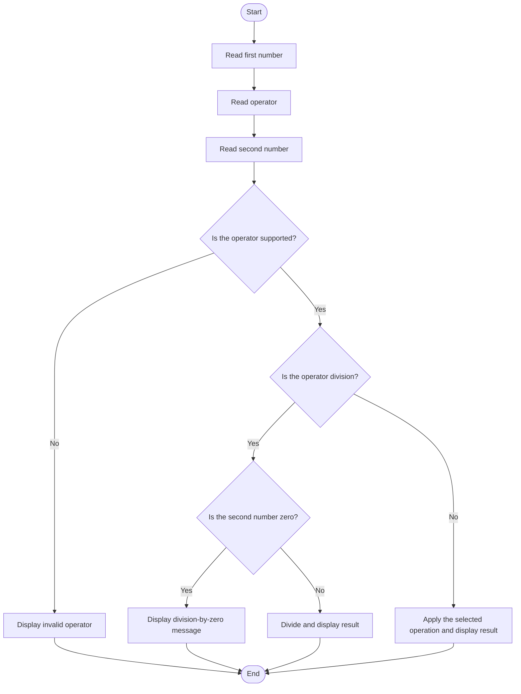

# Calculator

Read two numbers and an arithmetic operator, then display the result.

## Problem Summary
Perform addition, subtraction, multiplication, or division on two user-entered
numbers.

## Logic & Approach
The program reads two floating-point numbers and an operator. It applies the
matching arithmetic operation, reports division by zero instead of dividing,
and displays an error for an unsupported operator.

## Time & Space Complexity
| Measure | Complexity |
|---|---:|
| Time | O(1) |
| Space | O(1) |

## Example Input & Output
```text
Enter first number: 10
Enter operator (+, -, *, /): /
Enter second number: 2
Result: 5.0
```

## Program Flow


## Run
Run with Python 3:
```bash
python calculator.py
```
